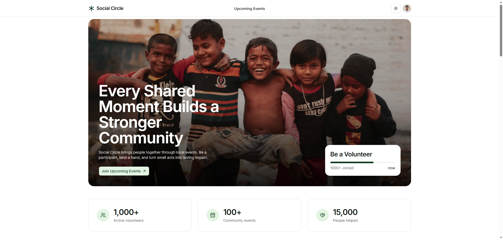
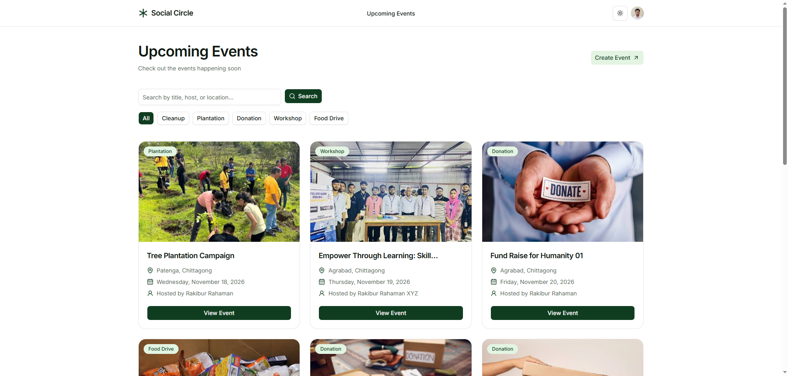
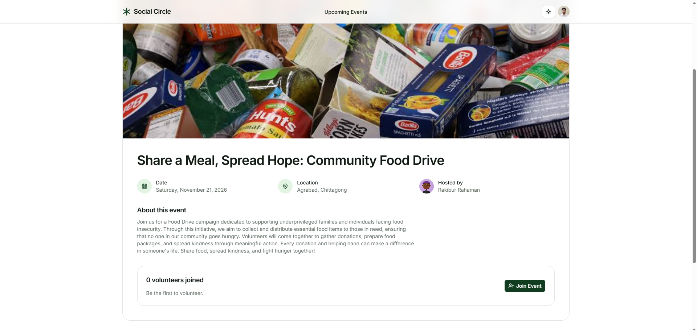
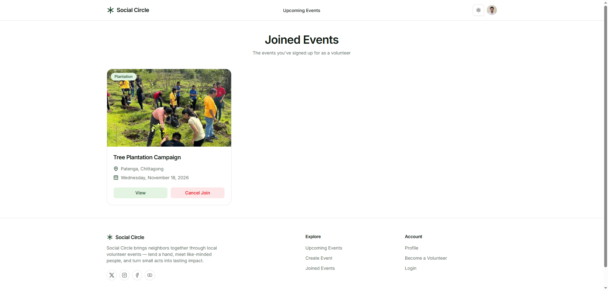

# Social Circle - Community Engagement Platform

**Social Circle** is a community engagement platform designed to bring people together through local events, volunteering opportunities, and social initiatives. It allows people to participate in meaningful activities, support their communities, and turn small acts of kindness into lasting impact.

## Screenshots

### Home Page

### Upcoming Events

### Detailed Event

### Joined Events

## Features

- **Upcoming Events:** Browse and explore only upcoming community events. Past events are not displayed in the upcoming events section.
- **Join Events:** Users can join events they are interested in and participate in community activities.
- **Create Events:** Authenticated users can create and publish their own community events.
- **Manage Created Events:** Users can view and manage events they have created, including updating event details and deleting events.
- **Joined Events:** Users can view all the events they have joined in one place.
- **Secure Authentication:** User authentication and authorization using Better Auth and JWT.
- **Community Initiatives:** Support various social activities, including food drives, donation campaigns, tree plantations, workshops, and winter clothing distributions.

## Tech Stack

### Frontend
- Next.js
- React
- TypeScript
- Tailwind CSS
- shadcn/ui

### Backend
- Node.js
- Express.js
- MongoDB

### Authentication & Authorization
- Better Auth
- JSON Web Token (JWT)
- MongoDB Adapter

### Deployment
- Vercel

## Live Links

- **Live Website:** [Social Circle](https://social-circle-client.vercel.app/)
- **Client GitHub Repository:** [Source Code](https://github.com/rakibur-rafi/social-circle-client)
- **Server GitHub Repository:** [Source Code](https://github.com/rakibur-rafi/social-circle-server)